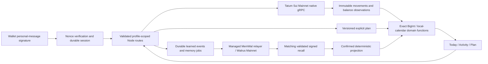

# Architecture

The application tracks one authenticated Sui Mainnet wallet per profile. Native USDC alone drives the plan; SUI and gas remain separate. The public demo is a read-only fictional dataset, never a fallback for failed live reads.

PostgreSQL is authoritative for exhaustive structured records, allocations, cursors and optimistic versions. Tatum is authoritative for observed chain facts. Semantic recall is bounded and cannot enumerate a financial ledger. Learned interpretations become active only after a completed write and matching validated recall; an explicit date, reserve or manual commitment activates on validated database persistence.

The operator owns a shared MemWal account. Each profile receives a stable opaque namespace derived server-side; the saved mapping survives secret rotation. The delegate is server-only. Namespace strings do not authorize access. Public seed data has a separate synthetic namespace and an operator-only job table.

`src/domain` contains network/framework-independent exact calculations. `src/adapters/tatum` uses installed Mysten generated types and native gRPC transport with TLS and `x-api-key` metadata. `src/adapters/memwal` wraps asynchronous jobs, exact-envelope recall validation and exhaustive metadata pagination. No public fallback RPC is configured. The wallet-selection client rejects attempted chain reads; wallet internals remain outside application control.

History is request-driven and bounded: resolve a 30-day checkpoint boundary with resumable binary-search progress, then consume one stream page per request. Ledger inserts and cursors commit atomically. No scheduled worker or permanent subscription is used. Stream failures preserve the last durable cursor for replay and deduplication.

Job states: queued → submitting → accepted → saved → recall_confirmed, with failed and submission_outcome_unknown branches. A crash after submission cannot justify an automatic second write. Unknown outcomes require event-ID reconciliation; a missing semantic hit is not proof of absence. A per-logical-key pending index and expected revisions serialize corrections.

Current release limitations are tracked in OPEN_ITEMS.md. In particular, a populated both-direction history and payment/balance consistency still need actual evidence. Production personal accounts are gated until required verification passes; the read-only demo/proof can be deployed for integration testing.
